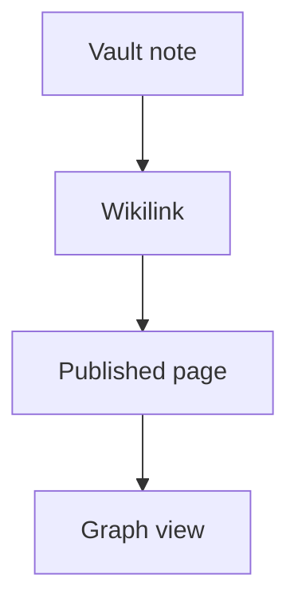

# Live Examples

Everything on this page is rendered by the plugin while this site builds;
nothing is a screenshot. This site turns on callouts, transclusion, media
embeds, backlinks, tag links and pages, daily notes, Dataview, math, Mermaid
and the default styles, so you can compare each source snippet in the guides
with its result here. Media formats have their own page:
[Media Embeds](/markdown/guide/media-embeds).

## Callouts

Each type has its own colour and icon. The [Callouts](./callouts.md) guide
lists the types and their aliases.

> [!success] Success Callout
> This is a success callout. Use it for positive outcomes.

> [!question] Question Callout
> This is a question callout. Use it for open questions.

> [!bug] Bug Callout
> This is a bug callout. Use it to track known issues.

> [!example] Example Callout
> This is an example callout. Use it for code samples or demonstrations.

> [!quote] Quote Callout
> This is a quote callout. Use it for citations or quotations.

> [!abstract] Abstract Callout
> This is an abstract callout (aliases: `summary`, `tldr`).

> [!failure] Failure Callout
> This is a failure callout. Use it for negative outcomes (aliases: `fail`, `missing`).

> [!check] Check Callout
> This is a check callout (alias of `success`; also: `done`).

A callout title is inline Markdown, so **bold**, *italics*, `code` and
[[markdown/guide/advanced|wikilinks]] all render inside it:

> [!example] A **bold** title linking to [[markdown/guide/advanced|Advanced Configuration]]
> The title above renders Markdown and a resolved wikilink, as Obsidian does.

`-` after the type collapses a callout by default, and `+` expands it:

> [!success]- Collapsed by Default
> This content is hidden until the user expands the callout.
> You can put multiple paragraphs inside.
>
> - Lists work too
> - And other markdown

> [!example]+ Expanded by Default
> This content is visible immediately, but the user can collapse it.

A callout can hold another callout:

> [!example] Outer Callout
> This is the outer callout containing a nested question.
>
> > [!question] Nested Question
> > This inner callout is fully processed and styled.
>
> Back to the outer callout content.

Three levels deep:

> [!abstract] Level 1
> > [!question] Level 2
> > > [!failure] Level 3
> > > Deepest content here.

### The types Rspress also claims

Rspress converts `note`, `tip`, `warning`, `danger`, `info`, `caution` and
`details` blockquotes into its own alerts before plugins run. That conversion
loses Obsidian's fold marker and the first paragraph of a multi-paragraph
callout. With `enableCallouts` on, the plugin restores the original blockquote
from the source and renders it as an Obsidian callout:

> [!note] Note Callout
> This is a standard note callout. Use it for general information.

> [!tip] Tip Callout
> This is a tip callout. Use it for helpful suggestions.

> [!warning] Warning Callout
> This is a warning callout. Use it for cautionary information.

> [!danger] Danger Callout
> This is a danger callout. Use it for critical warnings.

> [!info] Info Callout
> This is an info callout. Use it for supplementary details.

The fold marker and the first paragraph survive:

> [!note]- Collapsed by Default
> This content is hidden until the user expands the callout.
> You can put multiple paragraphs inside.
>
> - Lists work too
> - And other markdown

> [!tip]+ Expanded by Default
> This content is visible immediately, but the user can collapse it.

Nesting works for these types too:

> [!note] Outer Callout
> This is the outer note callout containing a nested tip.
>
> > [!tip] Nested Tip
> > This inner callout is fully processed and styled.
>
> Back to the outer callout content.

## Text Highlighting

You can ==highlight important text== using double equals signs. This is great for ==drawing attention== to key concepts in your documentation.

## Math

Inline math is written between single dollar signs: $E = mc^2$, and a formula
like $a^2 + b^2 = c^2$ flows with the text.

Display math uses double dollar signs:

$$
\int_0^1 x^2 \, dx = \frac{1}{3}
$$

KaTeX renders both at build time. Prices such as $5 and $10 stay prose, because
inline math cannot have a space just inside its delimiters. This page links
KaTeX's stylesheet because it has math; pages without math do not. See
[Math](./advanced.md#math).

## Mermaid Diagrams

A ` ```mermaid ` block becomes a diagram, drawn in the browser by the same
renderer that Canvas uses:



## Unresolved Links

A wikilink to a note that does not exist keeps the text a reader expects, and
is marked as unresolved instead of becoming a link:

```md
[[not-a-real-page|Missing page]]
```

This renders `Missing page` as `<span class="obsidian-unresolved">`, with the
reason as a tooltip, and the build reports the link through `onBrokenLink`. A
live example here would fail this site's build, so the page shows the source
instead.

## Private Notes

A comment hides everything between its delimiters, including paragraphs, lists
and headings. A heading inside a comment is also left out of the page outline
and the search index.

Visible text. %%

This paragraph is not published either.

- Neither is this list item.

%%

Still visible.

## Wikilinks

Links to other pages of these docs:

- [[markdown/guide/getting-started|Getting Started Guide]]: install and first build
- [[markdown/guide/advanced|Advanced Configuration]]: vaults, math, diagrams and diagnostics
- [[markdown/guide/api|API Reference]]: every option and export

Markdown links to notes resolve by the same rules, because Obsidian accepts
both syntaxes:

- [Markdown link to the guide](getting-started.md): the `.md` destination resolves like a wikilink
- [Markdown link to the vault root](/markdown/): resolves the section's index page. The trailing slash matters: Rspress rewrites a route without one to `/markdown.html`, while the published file is `markdown/index.html`
- [Markdown link with an anchor](getting-started.md#Install): the `#anchor` resolves to the heading's slug

A block link points to one paragraph, list item or table in another note:

- [[intro#^anchor-demo|A block in the vault's intro]]: hover it to preview only that paragraph

Links to headings on this page:

- [[#Callouts]]: jump to the callouts section
- [[#Footnotes]]: jump to the footnotes section

## Reference-Style Links

A reference-style definition is a link like any other, and counts as a
backlink to the page it names. The graph view and the backlinks panel read the
same set of links, so they always agree:

- [the getting started guide by reference][gs]
- [a section of it by reference][gs-install]
- [[markdown/guide/advanced]]: the same target the wikilink above resolves to

The demo vault's `create a link.md` note does the same, which is why it lists
this page in its backlinks panel.

A footnote or citation definition *looks* like a reference definition but
names no page, so neither becomes a backlink: a note[^ref-not-a-link] and a
citation[~cite] stay out.

## Dataview Inline Queries

With `enableDataview` on, inline code that starts with `=` is a Dataview
inline query, evaluated with `this` as the current page, as in Dataview. This
page's own name resolves:

The file name is `= this.file.name`, and its folder is `= this.file.folder`.

Inline code that starts with `$=` is inline DataviewJS: this site has
`$= dv.pages().length` pages.

Plain prose is never evaluated, so the sentence below reads exactly as written:

The speed = value.

See [Dataview](./dataview.md) for query blocks.

## Canvas Cards

The demo board shows how Markdown renders inside canvas cards: `==highlights==`
render in a card, and `![[Note#Heading]]` embeds only that section. See
[Canvas](/canvas/guide/getting-started).

[gs]: markdown/guide/getting-started.md
[gs-install]: markdown/guide/getting-started.md#Install
[~cite]: markdown/guide/advanced.md

[^ref-not-a-link]: A footnote definition is `[^id]: target` and a citation is `[~id]: target`; neither names a page, so neither is a link.

## Tags

This page has the tags #examples and #demo in its frontmatter. With
`enableTagLinking` on, inline tags like these become links, and with
`enableTagPages` on, each tag has a page listing every note that carries it.

## Footnotes

Footnotes are useful for citations and references[^1]. You can also use inline footnotes^[Like this one, which appears in the text itself] for brief asides.

Multiple footnotes work fine too[^2]. They are collected and rendered at the bottom of the page automatically.

## Obsidian Comments

Comments are stripped from the output. %% This text will not appear in the rendered page. %% Only the visible text remains.

Multi-line comments are also stripped:

%%
This entire block
is a private note
and will not be published.
%%

## Media Embeds

Every image, audio, video and PDF format that Obsidian accepts has a live
example on its own page: [Media Embeds](/markdown/guide/media-embeds).

## Transclusion Demo

The section below is the "What you get" section of the
[Getting Started](/markdown/guide/getting-started) page, embedded with a
heading transclusion (`![[Note#Heading]]`, see
[Transclusion](/markdown/guide/transclusion)). Edit that section, and this page
changes with it.

![[markdown/guide/getting-started#What you get]]

## Backlinks

Scroll to the bottom of this page to see the backlinks panel, which lists the
pages that link here.

[^1]: This is a labeled footnote definition. It appears at the end of the page.
[^2]: Another labeled footnote. The plugin handles duplicates gracefully.
